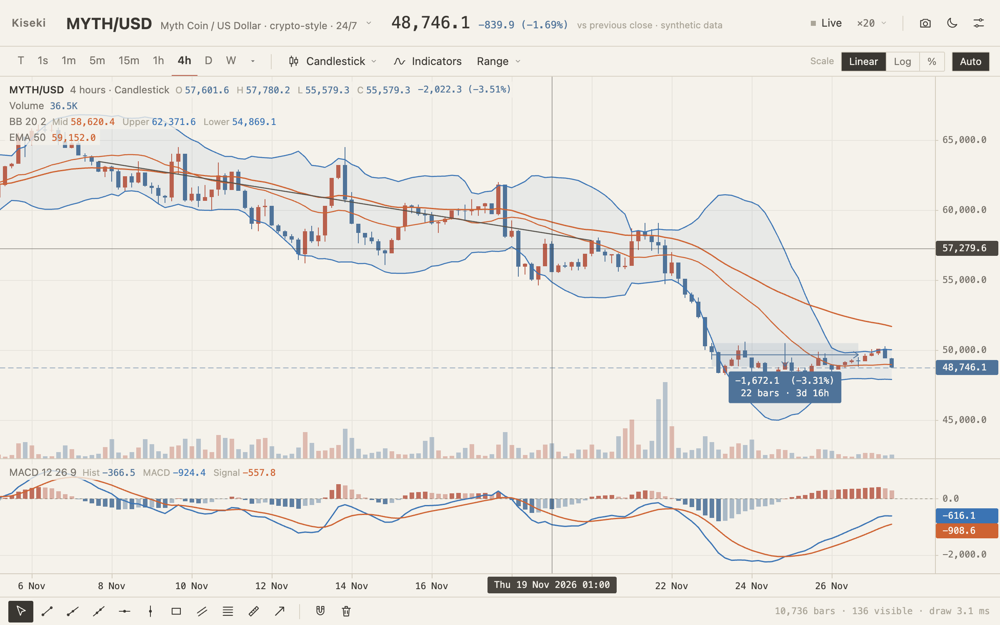
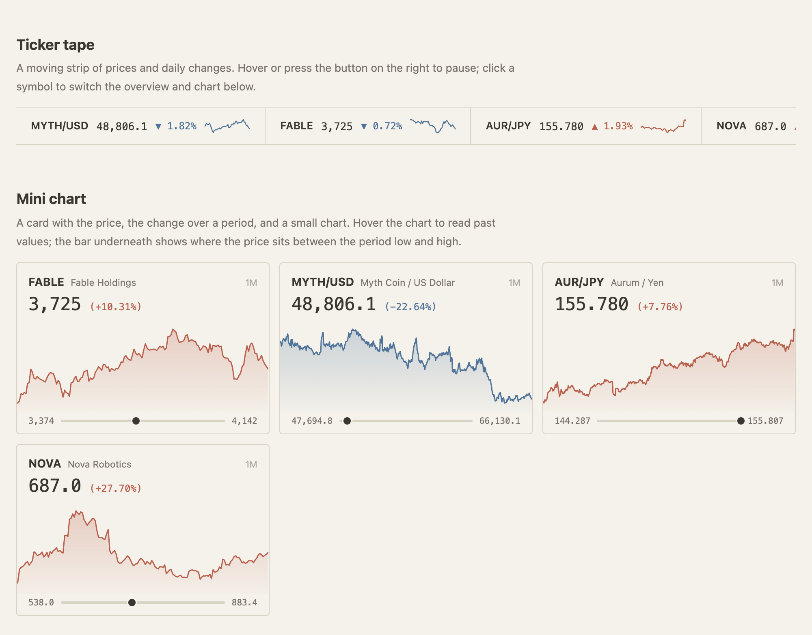
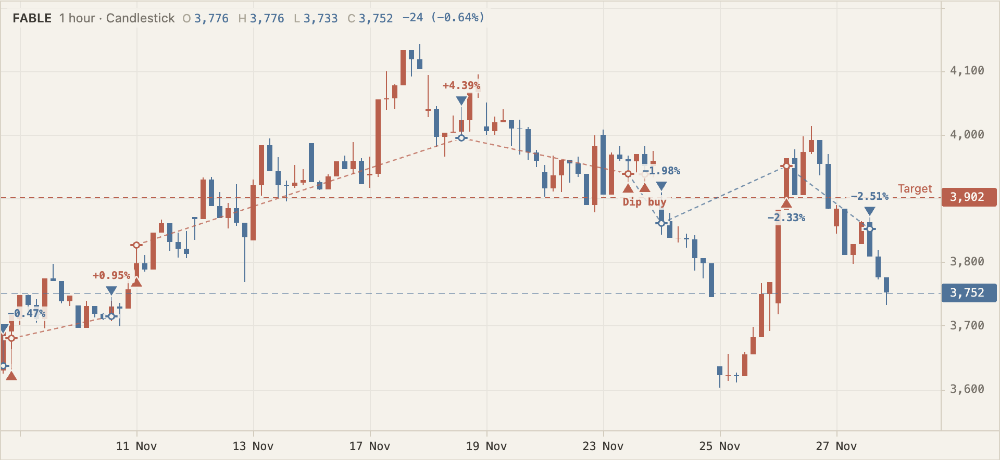

# Kiseki Chart

A dependency-free canvas charting engine and a set of embeddable chart widgets.
Candlesticks, lines and raw tick data are all drawn by the same machinery, and it stays fast with millions of points.

- **No dependencies** — plain ES modules, no build step, no third-party code at runtime or in development
- **Embeddable** — four widgets you can drop into any page with one script tag
- **Extensible** — chart types, indicators and drawing tools are all plugins registered through one small API
- **English and Japanese UI**



```bash
npm run dev    # serves the demo at http://localhost:5177 (a static server that needs only Node)
npm test       # unit tests (node:test)
```

The screenshots in `docs/` are made by `node tools/screenshots.mjs` (it drives a local Chrome; set `CHROME` if it is elsewhere).

Open `http://localhost:5177/` for the full chart and `http://localhost:5177/widgets.html` for the widget gallery.
Because there is no build step, any static file server works (GitHub Pages included).

All data in the demo is synthetic: the symbols are fictional and unrelated to any real market.

## Embedding in a web page



Load one script and write a tag. The gallery page (`widgets.html`) lets you change settings and copy the code.

```html
<script type="module" src="https://your.host/embed.js"></script>

<kiseki-ticker-tape symbols="MYTH/USD,FABLE,AUR/JPY" target=".follow"></kiseki-ticker-tape>
<kiseki-mini-chart symbol="FABLE" range="1M" style="width: 320px"></kiseki-mini-chart>
<kiseki-symbol-overview class="follow" symbols="MYTH/USD,FABLE" range="3M"></kiseki-symbol-overview>
<kiseki-advanced-chart class="follow" symbol="FABLE" timeframe="1h" style="height: 520px"></kiseki-advanced-chart>
```

| Tag | What it shows | Main attributes |
|---|---|---|
| `kiseki-advanced-chart` | The full chart: timeframes, chart types, indicators, drawing tools | `symbol` `timeframe` `type` `indicators` `hide` (`mast` `strip` `dock` `brand`) `symbol-change` `persist` `sample-trades` |
| `kiseki-symbol-overview` | Price, change over a period, a chart, and the period high / low / spread / volume. Several symbols become tabs | `symbols` `range` `type` |
| `kiseki-mini-chart` | A card with the price and a small chart, plus a bar showing where the price sits in the period range | `symbol` `range` |
| `kiseki-ticker-tape` | A scrolling strip of prices and daily changes with tiny sparklines | `symbols` `speed` `mode="static"` `target` |

Common attributes: `theme` (`light` / `dark` / `auto`), `scheme` (candle colors), `lang` (`en` / `ja`), `live="false"`.

- **Styles never mix.** Every widget renders inside a Shadow DOM, so host-page CSS and widget CSS cannot affect each other.
  [examples/embed-host.html](examples/embed-host.html) shows the widgets on a page with deliberately aggressive CSS.
- **Sizing** is ordinary CSS `width` / `height`. Layouts adapt to the widget's own width, not the viewport.
- **Linking.** Elements matched by the ticker tape's `target` selector get their `symbol` attribute set when a symbol is clicked.
  A `kiseki:symbol` event is dispatched as well.
- **Scrolling is never hijacked.** The overview and mini chart do not intercept the wheel or touch scrolling.
- **Motion can be stopped.** The tape pauses on hover, on keyboard focus, and with its button, and does not move at all when the
  OS asks for reduced motion. Direction is shown with ▲▼ as well as color.
- **No scripts allowed?** Use an iframe:
  `<iframe src="…/embed.html?widget=mini-chart&symbol=FABLE&range=1M" width="320" height="212" style="border:0"></iframe>`
- **From JavaScript**, call `createMiniChart(element, { symbol: 'FABLE' })` and friends; `destroy()` cleans up.
- **Real data.** Call `setFeed(yourFeed)` before placing widgets (see [Connecting data](#connecting-data)).

To load the widgets from another origin, serve `embed.js` and `src/` with CORS enabled (the bundled dev server does).

## Features

- **10 chart types** — candlestick, hollow candles, Heikin-Ashi, bars, high–low range, line, step line, area, baseline, columns
- **16 timeframes** — raw ticks, 10 / 100 / 1000-tick bars, 1 / 5 / 15 seconds, 1 minute to monthly
- **16 indicators** — SMA, EMA, WMA, Bollinger Bands, VWAP, Ichimoku, Parabolic SAR, volume, volume profile, volume bubbles,
  volume heatmap, RSI, MACD, Stochastic, ATR, OBV
- **9 drawing tools** — trend line, ray, extended line, horizontal / vertical line, rectangle, parallel channel,
  Fibonacci retracement, measure
- **Trade markers** — entries and exits at their exact time and price, with the result of each round trip, plus price lines
  for levels such as an average cost
- Multiple panes (drag the borders to resize), log and percent scales, two themes (Paper and Ink), three candle color schemes
- Live updates, CSV import by drag and drop (quoted cells, thousands separators and Shift_JIS files are handled), image export,
  automatic saving of settings and drawings

## Built for millions of points

The work per frame scales with the width of the screen, not with the number of bars.

| Mechanism | Role |
|---|---|
| Columnar `BarData` | Every column is a `Float64Array`. Ticks share one array for O/H/L/C, so they cost one price column |
| `MinMaxIndex` (LOD) | A pyramid of min / max over blocks of 16, 256, … bars. Used for range queries and for drawing when thousands of bars fall on one pixel |
| Resumable indicator math | `calc` only computes the changed range `[from, n)`, so a live tick costs constant time |
| Batched updates | `chart.update()` / `append()` only mark data dirty. Recalculation and drawing happen once, in the next frame |
| Two canvases | The crosshair and drawings live on their own layer, so moving the mouse never redraws the series |

Measured in the demo (median per frame): 1–2 ms with about 1.1 million ticks fully zoomed out, and 3–4 ms with about 2.7 million.
Add `?ticks=3000000` to the URL to change how many ticks are synthesized.

Memory is roughly 8 bytes × (3 + number of indicator buffers) per point, so several indicators on top of millions of points
can reach the browser's limits (a tab with 3 million points and five indicators, including Bollinger Bands and MACD, ran out of memory).

## Using the engine directly

```js
import { Chart, BarData } from './src/index.js';

const chart = new Chart(document.getElementById('chart'), { theme: 'light', type: 'candlestick' });

const data = BarData.from([
  { time: 1764000000000, open: 100, high: 104, low: 99, close: 103, volume: 1200 },
  // …
]);
chart.setSymbol({ name: 'DEMO', precision: 2 }, '1h');
chart.setData(data);

chart.addIndicator('sma', { length: 20 });
chart.addIndicator('rsi');
chart.setType('heikinashi');

// Live: overwrites the latest bar when `time` matches, appends when it is newer
chart.update({ time, open, high, low, close, volume });
```

For ticks, pass data created with `BarData.ticks()` and add points with
`chart.append({ time, open: p, high: p, low: p, close: p, volume: size })`.

Hosts with their own number and date formats can pass `formatPrice(value)`, `formatTicks(values)` (all axis tick labels at once)
and `formatTime(time, { kind: 'mark' | 'crosshair', … })`; returning nothing from `formatTime` keeps the built-in text.
`scheme` also accepts your own candle colors, `{ up, down }`, and `priceLine: 'label'` keeps the last-value label without the line.

The `baseline` chart type measures from the first visible close; `chart.setSeriesOptions({ base: 0, baseColor: '#888' })` measures
from a fixed value instead (which then always stays in the price range) and colors the baseline's own line.

Display options for small, embedded views: `legend` `priceAxis` `timeAxis` `grid` `interactive` `crosshair` `priceLine`
`rightOffset` `series`. `chart.fitTimeRange(from)` keeps the span from `from` to the latest bar fitted to the full width.

Main API: `setData` `update` `append` `setType` `addIndicator` `removeIndicator` `updateIndicator` `setTheme` `setScaleMode`
`showLastBars` `setVisibleTimeRange` `scrollToTime` `fitContent` `scrollToRealtime` `trades` `markers` `addPriceLine` `removePriceLine`
`toCanvas` `serialize` `restore` `on(event, fn)`

### Trade markers and price lines



`chart.trades` shows where a position was entered and left ("in" and "out"), at the exact time and price.
A working page is in [examples/trades.html](examples/trades.html); the demo has synthetic ones under Settings → Sample trades
(or `?trades=1`).

```js
chart.trades.set([
  // One fill: a time, a price and a side. `qty`, `label`, `tag`, `note` and `color` are optional.
  { time: 1764031020000, price: 3184, side: 'buy', qty: 100, label: 'Dip buy', note: 'Shown in the details' },
  // A round trip: entry and exit are joined by a line in the color of the result, and the exit shows it (+2.65%).
  { side: 'long', qty: 50, entry: { time: 1764050400000, price: 3210 }, exit: { time: 1764241200000, price: 3295 } },
  // No exit yet: an open position, with a line running on at its entry price.
  { side: 'short', qty: 50, entry: { time: 1764291600000, price: 3300 } },
]);

// A level of your own, such as the average cost of what is held (moving-average method).
const { avgPrice } = chart.trades.position();
chart.addPriceLine({ price: avgPrice, title: 'Avg cost', color: 'accent' });

chart.on('trade:click', ({ items }) => chart.trades.reveal(items[0]));   // items are the objects you passed in
```

- **Exact in time.** A fill lands on the bar that contains its time, never between two bars, and times are kept as times:
  the same list stays right on every timeframe, on tick bars, and while live bars arrive.
- **Exact in price.** A ring and a tick mark the price on the bar itself. The arrow (up from below for a buy, down from above
  for a sell) stays outside the candle so it hides nothing, but never strays far from its price.
  Visible fills are kept inside the price range.
- **Readable when crowded.** Zoomed out, fills that would overlap share one arrow (×n) while their marks stay in place,
  and labels give way to newer ones instead of piling up. The cost per frame depends on the screen, not on the number of fills.
- **Details on hover.** Pointing at a marker shows the side, price, quantity, time, result and holding period, draws the exact
  price across the pane and puts it on the price axis. A tap does the same on touch screens.
  `trade:hover` and `trade:click` let the host react.

Also: `add(entry)` `remove(idOrEntry)` `clear()` `visible` `reveal(idOrEntry)` `position()` and
`setOptions({ labels, connectors, openLine, autoscale, colors: { buy, sell, profit, loss }, formatQty })`.
Colors follow the candle scheme unless set. `side` also accepts `'in'` / `'out'`.
`label` names a fill (it heads the details); `tag` is the short text printed beside the arrow instead (it defaults to `label`).
On a touch screen a tapped marker keeps its details open until the next tap.
`addPriceLine({ price, title, color, dash, width, axisLabel, autoscale, box })` returns the line for
`updatePriceLine` / `removePriceLine`.
`autoscale: true` keeps the line in the price range; `autoscale: 'near'` does so only while the line is within one price
range's height of the visible bars, so a target just above the highs is shown and one far away does not flatten the
candles. `box: true` prints the title in a box at the right edge (surface color, the line's color as the border, plain text
inside; boxes keep clear of each other) instead of as colored text above the line.

### Markers on bars

`chart.markers` puts a small shape with a short text above or below a bar: journal pins, dividends, notes, events. Unlike
trade markers they have no price; they sit just outside the bar's high or low, and several on one side of a bar stack.

```js
chart.markers.set([
  { time: 1764031020000, position: 'above', shape: 'circle', color: 'accent', text: 'J', id: 'entry-12' },
  { time: 1764031020000, position: 'below', shape: 'square', color: '#2a7', text: 'D' },
]);
chart.on('marker:click', ({ items }) => open(items[0].id));   // items are the objects you passed in
chart.on('marker:hover', (hit) => showHint(hit));              // null when the pointer leaves
```

- `position` is `'above'` (default) or `'below'`; `shape` is `'circle'` (default), `'square'`, `'arrowUp'` or `'arrowDown'`;
  `color` is a CSS color or a role name (`'up'`, `'down'`, `'accent'`, …).
- A marker lands on the bar that contains its `time`, so the same list stays right on every timeframe.
- Hover and click are hit-tested within 14 px of a marker's centre; the chart draws no tooltip, the host decides what to show.
- Also: `add(item)` `remove(idOrItem)` `clear()` `visible` `items` `count`.

## Figures

`Chart` draws bar-indexed time series. **Figures** are for everything else: a sparkline, a fan of bands over time, a bump
chart, a bar chart on categories, a grid of cells, a donut, a treemap. A figure owns one canvas inside a container, is drawn from `setData`,
and tells the host where everything is, so the host can lay real DOM controls over it. A working page is in
[examples/figures.html](examples/figures.html).

```js
import { CartesianFigure, createFigure } from './src/index.js';

// A preset by name. A fixed width and height means no ResizeObserver, so a page can hold hundreds of them.
const spark = createFigure(el, 'sparkline', { width: 88, height: 24, baseline: 'start', tone: 'direction' });
spark.setData([101, 103, 102, 108]);

// A plot composed from marks. A missing width or height follows the container (which then needs a size of its own).
const fig = new CartesianFigure(el, {
  margin: { top: 8 },
  x: { scale: 'time', axis: { ticks: 5, format: (t) => new Date(t).toISOString().slice(0, 7) } },
  y: { axis: { format: (v) => v.toFixed(1) }, grid: true, include: [0] },
});
fig.setData([
  { type: 'area', points: [{ x: t0, y0: 1, y1: 3 }, { x: t1, y0: 2, y1: 5 }], color: 0, opacity: 0.2 },
  { type: 'line', id: 'you', datum: row, points: [{ x: t0, y: 2 }, { x: t1, y: 4 }], color: 'series', width: 2 },
  { type: 'text', at: 'end', y: 4, text: 'You', place: { group: 'ends', mode: 'spread', gap: 15 } },
]);
fig.on('layout', (marks) => placeControls(marks));       // after every layout
fig.on('click', ({ mark }) => select(mark?.datum));       // pointer events are only listened to once a handler is added
```

- **Every figure** (`Figure`, an `EventEmitter`): `setData` `setOptions` `setTheme` `setActive(id)` `setSelected(id)` `markAt(x, y)`
  `markById(id)` `toCanvas()` `destroy()`. Options `theme` / `scheme` (the same theme objects and color roles as `Chart`),
  `width` / `height`, `hitSlop`, `emphasis`. Drawing is batched into one animation frame shared by all figures,
  follows the device pixel ratio, and never animates. A figure never takes the wheel or a touch drag from the page.
- **`marks`** is what was drawn that has an `id`, in CSS px relative to the canvas: `{ id, datum, kind, x, y, w, h }` plus
  `cx cy r` for a `'circle'` and `runs` (polylines) and `tol` for a `'path'`. `x y w h` is always the bounding box.
  `'layout'` is emitted after each layout; `'hover'` and `'click'` carry `{ mark, x, y }` (`mark` is `null` off a mark).
  `setActive` draws a ring (a halo behind a line) for keyboard focus; `setSelected` the same for a selection.
- **`CartesianFigure`**: x and y scales (`linear`, `time` in UNIX ms, `band`; either can be `reverse`d; the domain comes from
  the marks unless given), optional axes and grid with host-formatted labels (`format(value)` or `formatTicks(values)`),
  and margins that fit the labels and the end labels. Marks are drawn in the order given:
  `line` (gaps, step, halo, dash; `fade` makes a trail whose segments grow more opaque, `vertices` dots its points) · `area`
  (between `y0` and `y1`) · `bar` (vertical or horizontal; give each segment its own `from` / `to`, see `stackValues`, for
  stacked or diverging bars; `pattern` hatches it, `strokeInside` keeps an outline within its size) · `dot` (optionally outlined, dashed) · `rule` · `region` (outlined; `label` prints words in a
  corner) · `cell` (band × band; dashed outline, `shade`, and a `label` that can start or end at an edge and be cut with an ellipsis) · `text` (`at: 'end'` end labels; `place` keeps labels from overlapping; `rotate`) · `arrow` (an exact
  `headLength` × `headWidth`) · `link` (an S-shaped ribbon between two points, `direction: 'h' | 'v'`). Colors are CSS colors, palette indices
  or role names (`'up'` `'down'` `'accent'` `'muted'` `'text'` `'series'` `'grid'` `'axis'` `'faint'` `'surface'` …).
- **Presets** are registered in `figureTypes` (`'cartesian'`, `'sparkline'`, `'donut'`, `'treemap'`) and created with `createFigure(el, id, options)`.
  `'sparkline'`: a line on its own y scale, a dashed baseline at the first value (`baseline: 'start'`), at a number, or none
  (`null`), and an end dot that follows the direction of the change (`tone: 'direction'`) or has the line's color.
  `'donut'`: `setData([{ id, value, color, datum }])` draws ring sectors (`outer`, `innerRatio`, `cornerRadius`, `padAngle`, an optional
  `label` in the middle); each sector with an `id` is a `'arc'` mark. `'treemap'`: `setData([{ id, value, fill, border, stripe, lines }])`
  lays the tiles out squarified (`gap`, rounded to whole pixels) and prints each tile's `lines` while they fit; a tile's mark says
  how many lines were `shown`, so a host can show the rest elsewhere.
  Add your own the way `seriesTypes` works: extend `Figure` (implement `paint(ctx)`, call `this.expose(...)` for marks that can be
  pointed at) and `figureTypes.register(Class)`; new marks go through `markTypes.register({ id, extent, draw })`.
- **Pure helpers**, tested without a DOM: `linearScale` `timeScale` `bandScale` `makeScale` `timeTicks` (calendar ticks)
  · `spreadLabels` `placeTickLabels` `placeBoxes` · `stackValues` · `hitTest` · `nextInDirection` (the mark to move to with an arrow
  key, for tiles and cells) · `squarify` `fitLines` `ellipsize` (treemap; they live in `layout.js`, so they load without a figure) · `donutSlices` `sectorOutline` `sectorBounds` (donut) ·
  `fadeOpacities` `linkPoints`.
- **Words.** Figures print no words of their own: tick labels, end labels and text marks all come from the host.

## Extending

There are three registries for `Chart` (`figureTypes` and `markTypes` are described under [Figures](#figures)). The built-ins are registered through the same API, so plugins are treated exactly like them, and the
UI lists the registries directly, so whatever you register shows up in the menus.
Working examples of each are in [examples/plugins.js](examples/plugins.js).

### Indicators

Write a declaration (inputs and plots) and the calculation. The settings dialog, legend, value range and LOD come for free.

```js
import { indicators, math } from './src/index.js';

indicators.register({
  id: 'donchian',
  name: 'DC',
  title: 'Donchian Channel',
  overlay: true,                       // overlay on the main pane (false gives it its own pane)
  precision: 'inherit',                // same decimals as the price
  inputs: { length: { type: 'int', label: 'Length', default: 20, min: 1 } },
  plots: [
    { type: 'band', a: 'upper', b: 'lower', color: 6, opacity: 0.06 },
    { key: 'upper', type: 'line', color: 6 },
    { key: 'lower', type: 'line', color: 6 },
  ],
  calc({ data, inputs, out, from, n }) {
    math.highest(data.high, inputs.length, out.upper, from, n);
    math.lowest(data.low, inputs.length, out.lower, from, n);
  },
});
```

`calc` fills `out[key][from..n-1]`. Everything before `from` still holds the previous results, so recursive indicators
(EMA, SAR, …) can read them and continue.
Plot types are `line` / `histogram` / `dots` / `band` / `cloud` / `custom`. A numeric color is an index into the theme's
categorical palette; `'up'`, `'down'` and `'accent'` are role colors.
`custom` plots implement `draw(view, ctx, self)` themselves and suit things whose shape depends on the visible range
(the volume profile, bubbles and heatmap are built this way — see [src/indicators/volume.js](src/indicators/volume.js)).
Values the host computed itself (a benchmark, a forecast band, a series that is not derived from the bars) go through an input
of any type, e.g. `inputs: { values: { type: 'data', default: null, inTitle: false } }`: `chart.updateIndicator(ind, { values })`
recalculates, and `calc` copies the values into `out[key]`. A `custom` plot with a `key` and `range: true` takes part in the
price range, so a shaded band can be autoscaled to.
A line's color, width, dash and axis label can be set per instance: `chart.addIndicator('sma', { length: 25 }, { value: { color: '#c60', width: 1, dash: [5, 4], axisLabel: false } })`
(the keys are the plots' `key`s; `chart.updateIndicator(ind, inputs, styles)` changes them later).
Every field of a definition is documented at the top of [src/indicators/Indicator.js](src/indicators/Indicator.js).

### Chart types

Extend `Series` and implement `draw(view)`. With the primitives in [src/core/plots.js](src/core/plots.js)
(`strokeLine`, `fillArea`, `fillBand`, `drawColumns`, …), thinning at dense zoom levels is handled for you.

```js
import { Series, seriesTypes, plots } from './src/index.js';

class DotSeries extends Series {
  static id = 'dots';
  static label = 'Dots';
  draw(v) {
    plots.drawDots(v, this.data.close, this.data.length, v.theme.accent, 2);
  }
}
seriesTypes.register(DotSeries);
```

### Drawing tools

Give the number of points, how to draw, and how to hit-test. Points are stored as time and price, so drawings stay in place
when the timeframe changes.

```js
import { drawingTools, distToSegment } from './src/index.js';

drawingTools.register({
  id: 'segment',
  label: 'Segment',
  icon: 'M5 18L19 6',                  // a 24×24 SVG path
  points: 2,
  draw(ctx, p) { ctx.beginPath(); ctx.moveTo(p[0].x, p[0].y); ctx.lineTo(p[1].x, p[1].y); ctx.stroke(); },
  hit: (p, x, y) => distToSegment(x, y, p[0].x, p[0].y, p[1].x, p[1].y) < 6,
});
```

### Translations

Source strings are English and pass through `t()` when displayed. A translation is a dictionary keyed by the English text.

```js
import { addMessages, setLocale, t } from './src/index.js';

addMessages('ja', { 'Donchian Channel': 'ドンチャン・チャネル' });
setLocale('ja');
chart.refreshLocale();                         // rebuilds the legend and axis labels
t('{n} drawings removed', { n: 3 });           // → '3 件の描画を削除しました'
```

### Connecting data

The chart knows nothing about where data comes from. Provide an object shaped like the demo feed in
[src/data/feed.js](src/data/feed.js) — `symbols`, `symbol(id)`, `timeframes(id)`, `history(id, tf)` and
`subscribe(id, tf, onBar, history)` — and pass it to `setFeed()` to switch to real data.

## Design

The look is "paper and ink", tuned to stay comfortable over long sessions. Colors, fonts and line treatment live in
[src/core/theme.js](src/core/theme.js) and [src/widgets/styles.js](src/widgets/styles.js).

- **Chrome never outweighs data** — rules are faint 1px lines; vertical rules are clear only at major boundaries such as dates
- **Moderate saturation and contrast** — text is a dark ink tone rather than pure black; up / down are a calm vermilion and indigo
- **One accent color** — selection is shown by inverting light and dark or by an underline. No gradients, no blinking,
  and shadows only, faintly, under floating surfaces such as menus
- **Vermilion and indigo candles** — easier to tell apart under color-vision deficiencies than red / green (which is still available)
- **Indicator colors** — the palette order was validated so that neighbouring colors stay distinguishable regardless of
  color vision and keep at least 3:1 contrast with the background
- **Single-hue heatmap** — rainbow scales make order hard to read, so volume is shown as one hue getting darker
- **System sans-serif for text, monospaced digits** — columns line up and prices are easy to scan

## Project layout

```
src/
  core/        Chart, scales, LOD, drawing primitives, interaction, themes, i18n
  series/      chart types
  indicators/  indicator runtime, math helpers, built-in definitions
  drawings/    drawing tools
  trades/      trade markers (entries and exits at their exact time and price)
  markers/     markers on bars (pins, dividends, events)
  figures/     charts that are not bar-indexed time series (sparkline, plots composed from marks)
  data/        timeframe aggregation, synthetic data, CSV
  widgets/     embeddable widgets (advanced chart, symbol overview, mini chart, ticker tape)
  ui/          entry points of the demo page and the widget gallery
embed.js       entry point for embedding (loading it registers the <kiseki-…> tags)
embed.html     page for iframe embedding
examples/      plugin examples, an example host page, and a trade marker example
test/          unit tests
tools/         dev server and the in-browser randomized stress test
```

## Testing

- `npm test` runs the unit tests. Besides the LOD index, scales, aggregation, CSV parsing and trade marker placement, they
  check for every indicator that bar-by-bar incremental results equal a full recalculation, and that values match
  independently written naive implementations.
- **Randomized stress test** — with the demo page open, run
  `(await import('/tools/fuzz.browser.js')).run({ steps: 500, seed: 1 })` in the console. It calls the public API in random order
  with extreme values and looks for exceptions and inconsistent state. Auto-saving is paused while it runs; reload afterwards.

## Controls

| Input | Action |
|---|---|
| Drag | Pan (keeps gliding when released) |
| Wheel / pinch | Zoom around the cursor |
| Drag the price or time axis | Rescale (double-click to reset) |
| ← → / ↑ ↓ / Home / End | Pan / zoom / oldest / latest |
| Esc / Delete | Cancel drawing / remove the selected drawing |
| Point at / tap a trade marker | Exact price, time and result |
| Point at / tap a bar marker | `marker:hover` / `marker:click` for the host |

## License

[MIT](LICENSE)
